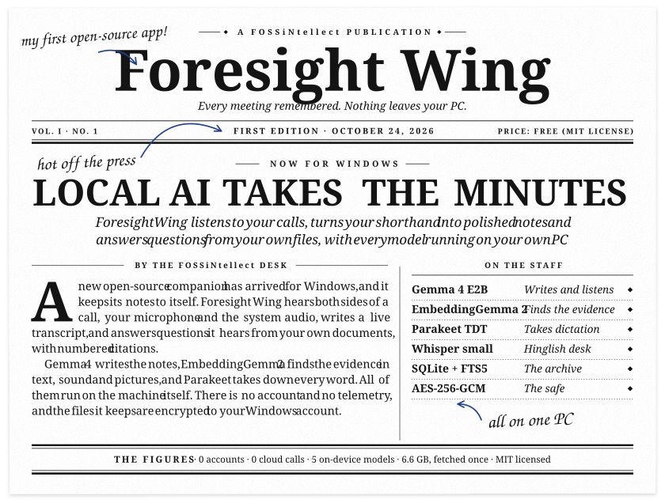
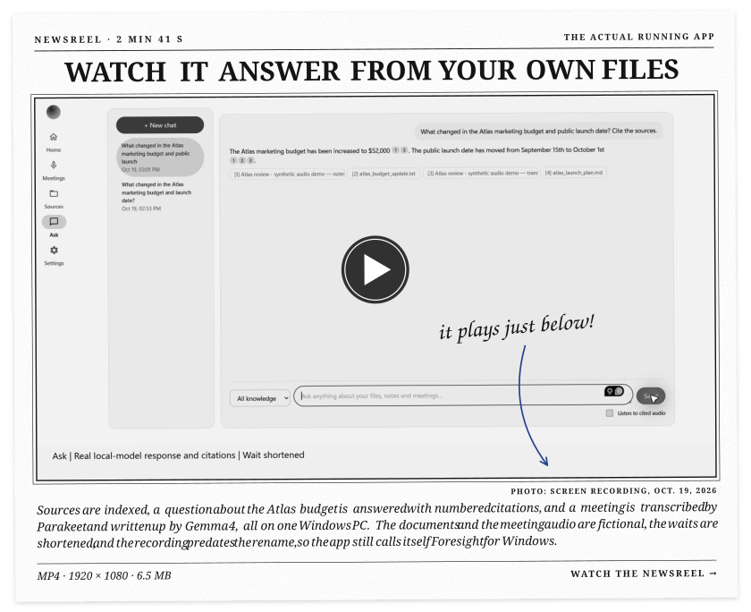
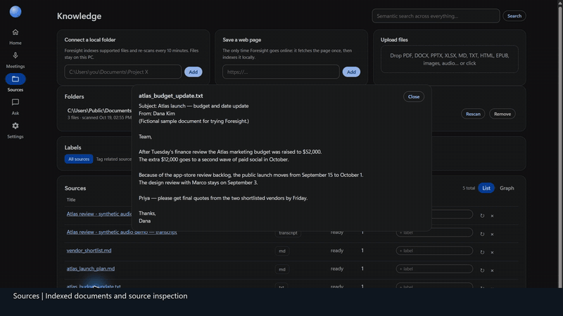
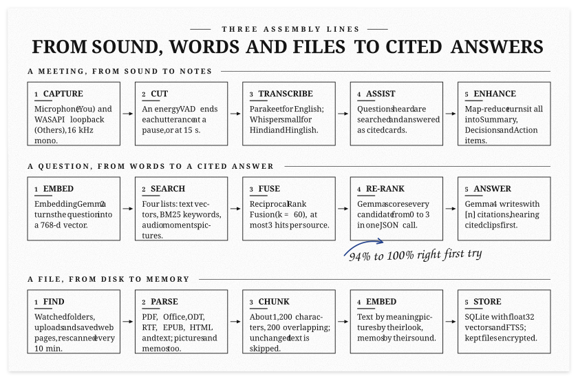
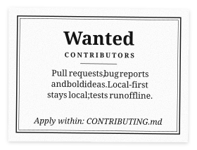
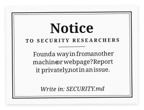

<!-- The newspaper pages are printed by docs/press/press.py from docs/press/edition.toml. The text below is plain Markdown. -->
<div align="center">

<picture><source media="(prefers-color-scheme: dark)" srcset="docs/readme/dark/front-page.svg"></picture>

</div>

<details>
<summary><b>Read the plain-text front page</b> (for screen readers, small screens and search engines)</summary>

### Foresight Wing
*Every meeting remembered. Nothing leaves your PC.* · A FOSSiNtellect publication · Vol. I, No. 1 · First edition, October 24, 2026

#### LOCAL AI TAKES THE MINUTES
*Foresight Wing listens to your calls, turns your shorthand into polished notes and answers questions from your own files, with every model running on your own PC.*

**BY THE FOSSiNtellect DESK**

A new open-source companion has arrived for Windows, and it keeps its notes to itself. Foresight Wing hears both sides of a call, your microphone and the system audio, writes a live transcript, and answers questions it hears from your own documents, with numbered citations.

Gemma 4 writes the notes, EmbeddingGemma 2 finds the evidence in text, sound and pictures, and Parakeet takes down every word. All of them run on the machine itself. There is no account and no telemetry, and the files it keeps are encrypted to your Windows account.

**On the staff:** Gemma 4 E2B (writes and listens) · EmbeddingGemma 2 (finds the evidence) · Parakeet TDT (takes dictation) · Whisper small (Hinglish desk) · SQLite + FTS5 (the archive) · AES-256-GCM (the safe)

**The figures:** 0 accounts · 0 cloud calls · 4 on-device models · 6.6 GB, fetched once · MIT licensed

</details>

<div align="center">

<picture><source media="(prefers-color-scheme: dark)" srcset="docs/readme/dark/section-newsreel.svg"></picture>

<a href="docs/media/foresight-wing-demo.mp4?raw=true"><picture><source media="(prefers-color-scheme: dark)" srcset="docs/readme/dark/newsreel.svg"></picture></a>

</div>

**▶ [Download the demo video](docs/media/foresight-wing-demo.mp4?raw=true)** (MP4 with narration, 2 min 41 s, 6.5 MB). It is the real app on a real Windows PC: sources are indexed, a question is answered from them with numbered citations, and a meeting recording is transcribed by Parakeet and written up by Gemma 4. The documents and the meeting audio are fictional, the waits are shortened, and the video was recorded on October 19, 2026, before the rename, so the app still calls itself *Foresight for Windows*.

<details open>
<summary><b>Silent preview</b>: asking a question, then the meeting notes, at double speed (32 s)</summary>



</details>

<div align="center">

<picture><source media="(prefers-color-scheme: dark)" srcset="docs/readme/dark/section-prerequisites.svg"></picture>

</div>

## Prerequisites

### To use it

| You need | Details |
|---|---|
| **Windows 10 or 11, 64-bit** | Developed and tested on Windows 11. System audio is captured through WASAPI loopback, and the files key is protected by Windows DPAPI, so Windows is required. |
| **A 64-bit (x64) CPU** | Everything runs on the CPU, and no GPU is needed. Ollama uses a supported GPU on its own if you have one. |
| **8 GB of RAM or more** | 16 GB is comfortable. Gemma 4 E2B (a 4.3 GB download) stays loaded for 30 minutes after it was last used (`FORESIGHT_KEEP_ALIVE`). The larger `gemma4:e4b-it-qat` wants 16 GB free. |
| **About 10 GB of free disk** | The installed app (1.5 GB, speech models included), Gemma 4 E2B (4.3 GB) and EmbeddingGemma 2 (1.3 GB), Ollama itself, and room for your data. Kept meeting audio adds about 14 MB per hour per source. |
| **Ollama** | It serves the two Gemma models on `127.0.0.1:11434`. **Set up now** inside the app installs it for you (only if Windows confirms the installer is signed by Ollama Inc.), or get it from [ollama.com](https://ollama.com/download/windows). Developed with Ollama 0.40.10; older versions may lack Gemma 4's audio input. |
| **Microsoft Edge** | It ships with Windows. The app opens in Edge's app mode, with its own profile, extensions and sync turned off. Without Edge, your default browser opens it instead. |
| **A microphone and an output device** | The microphone records your side ("You"); the speakers or headset you hear the call on are recorded through loopback ("Others"). Either one can be switched off. |
| **Internet, once** | To download Ollama and the two models: about 6.6 GB in all. After that everything works offline. |
| **An account** | None. There is no sign-in, no API key and no subscription. |

### To run from source

Everything above, plus:

| You need | Details |
|---|---|
| **Python 3.10 or newer** | Developed and tested on Python 3.13. `setup.bat` checks it and says how to install it (from [python.org](https://www.python.org/downloads/windows/), or `winget install --id Python.Python.3.12 -e`). |
| **Git** | To clone this repository. |
| **The Python packages** | `requirements.txt`, installed by `setup.bat` or `pip install -r requirements.txt`: **web server** `fastapi`, `uvicorn`, `python-multipart`, `httpx` · **speech and audio** `onnx-asr[cpu,hub]`, `faster-whisper`, `soundcard`, `av`, `numpy` · **documents** `pypdf`, `python-docx`, `openpyxl`, `beautifulsoup4`, `lxml` · **the app** `Pillow`, `cryptography`, `pystray`, `tzdata` |
| **The two Ollama models** | `ollama pull gemma4:e2b-it-qat` (about 4.3 GB) and `ollama pull embeddinggemma-2:740m` (about 1.3 GB). `setup.bat` offers to pull them. |
| **The speech weights** | From Hugging Face, into your local cache: [`istupakov/parakeet-tdt-0.6b-v3-onnx`](https://huggingface.co/istupakov/parakeet-tdt-0.6b-v3-onnx) (about 670 MB; only the int8 files are used) and, for Hindi / Hinglish meetings, [`Systran/faster-whisper-small`](https://huggingface.co/Systran/faster-whisper-small) (about 480 MB). `setup.bat` offers to download them. The app itself never downloads anything (`run.py` sets `HF_HUB_OFFLINE=1`). |
| **pytest** | Only to run the tests: `pip install pytest`. |

### To build the installer

Everything for running from source, plus:

| You need | Details |
|---|---|
| **PyInstaller** | `pip install pyinstaller`. Built and tested with PyInstaller 6.21. |
| **The speech weights in your cache** | The build copies them into the app, so the installed app needs no download for speech. |
| **About 4 GB free in `%LOCALAPPDATA%`** | The build writes to `%LOCALAPPDATA%\ForesightBuild`: the app folder (1.46 GB), the installer (1.11 GB) and work files. It stays outside the project folder so a synced folder such as OneDrive does not upload it. |
| **4 to 8 minutes** | On the development PC a full build took 4 to 6 minutes. |

<div align="center">

<picture><source media="(prefers-color-scheme: dark)" srcset="docs/readme/dark/section-features.svg"></picture>

</div>

## Features

| What it does | How |
|---|---|
| Scribble shorthand, then Auto-Enhance into polished notes | Meeting → *Notes* (Shorthand / Enhanced). Map-reduce over long transcripts, with Summary, Decisions and Action items |
| Works for calls and in-person meetings | Captures **microphone** ("You") and **system audio via WASAPI loopback** ("Others"), or both |
| English and Hindi / Hinglish meetings | Pick the language when you start or import a meeting. English uses Parakeet live. Hindi / Hinglish uses Whisper `small` live as a preview; afterwards Gemma 4 listens to the saved audio again, rewrites every line in Latin-letter Hinglish and adds any speech live transcription missed. Replaced wording is kept, so changes can be undone, and the audio is deleted afterwards unless *Keep meeting audio* is on |
| Live Assistance answers spoken questions | A question detector watches the transcript, runs RAG over your files and shows a proactive card with citations |
| Floating live answers | **⧉ Float** on a meeting while it records: live answers, the last two lines said and an Ask box in a small window that stays on top of your call (Document Picture-in-Picture in Chrome and Edge; an ordinary small window in other browsers) |
| Point it at folders, docs and web links | Knowledge → local folders (re-scanned every 10 min), uploads (PDF, DOCX, PPTX, XLSX, ODT, RTF, EPUB, HTML, MD, TXT, CSV, JSON) and saved web pages |
| Conversational retrieval with citations | Chat, scoped to all knowledge or to one label. Gemma re-ranks the top candidates against the question before answering (Settings → *Let Gemma re-rank sources before answering*, on by default; about 6 s more per answer) |
| Date questions | "What did we decide in last Tuesday's meeting?" searches only the meetings recorded then, and Gemma is told which ones those are. Understands today / yesterday / this morning, weekdays, last week / month, "3 days ago", dates like 12 October, and the Hinglish forms (kal, parso, pichle hafte, …) |
| Document graph | Sources → *Graph*: every source is a dot, joined to the sources whose content is most alike (EmbeddingGemma 2, only pairs well above the collection's usual similarity), with labels as hubs. Click a dot for its closest neighbours, find one by name, or narrow it to a label |
| Semantic labels → wiki with conflict detection | Tag sources with a label, then **Build wiki page**. It lists contradictions such as a $40k vs $52k budget |
| Meeting import | Import an audio recording (wav, mp3, m4a, …) to transcribe it into a meeting |
| Daily Briefings before each meeting | Home → *Upcoming*: for every event in the next 24 hours, the most relevant sources and similar past meetings, plus a 3-bullet "what to know" summary from Gemma, cited and cached until the event changes. **Start this meeting** opens it with the event title |
| Calendars without a sign-in | Settings → *Calendars*: local `.ics` files or subscription URLs (`https://` or `webcal://`, such as a calendar's private iCal address), re-synced every 15 min. Daily and weekly RRULEs, EXDATEs, moved instances and time zones are expanded with the standard library |
| Replay what was said | Settings → *Audio memory* (off by default): keeps meeting audio as Ogg Opus (about 14 MB per hour per source) and imported recordings. Click a transcript line to hear it. Kept for 7, 30 or 90 days, or until deleted. Design: [`docs/multimodal-memory-design.md`](docs/multimodal-memory-design.md) |
| Search the audio itself | Kept audio is cut into ~20 s moments and embedded by EmbeddingGemma 2 straight from the sound, in the same space as text. Questions find the moment it was said (even past transcription errors), and citations get a ▶ that plays just that moment. Weight in search: `FORESIGHT_MEDIA_WEIGHT` (default 0.5) |
| Pictures | Photos, screenshots, charts and scanned receipts (png, jpg, webp, gif, bmp) in folders and uploads. Gemma 4 describes each one and copies any text in it, EmbeddingGemma 2 embeds the picture itself, so words or a description of how it looks find it. Citations show a thumbnail that opens the full picture, and Gemma looks at up to two cited pictures when it answers. Settings → *Index pictures in watched folders* (on; pictures under 12 KB are skipped, and they wait while a meeting records) |
| Voice memos | Audio files (mp3, m4a, wav, ogg, opus, flac, aac) in folders and uploads are transcribed locally into timestamped lines and cut into ~20 s moments that EmbeddingGemma 2 embeds from the sound. Citations get a ▶ that plays the moment from your own file (never copied or changed). Uses the default meeting language. Settings → *Transcribe audio files in watched folders* (on; files under 48 KB are skipped, and they wait while a meeting records) |
| Gemma listens | Gemma 4 hears kept audio when you ask it to. **✦** on a transcript line (or **Ask** next to a cited moment) asks about that moment. Chat's *Listen to cited audio* does the same for up to two cited clips. Gemma first transcribes each clip on its own (numbers and amounts as said), its words replace the transcript lines that clip covers, and the answer shows what was heard. Speech recognition's mistakes, such as "€400" for "four thousand euros", then do not reach the answer. **↻** on a line suggests Gemma's own transcription, which you can accept or ignore |
| Files encrypted at rest | Meeting audio, recordings, uploads and thumbnails are AES-256-GCM encrypted with a key only your Windows account can unwrap. See [Security and privacy](#security-and-privacy) |
| Token stats | Home → on-device usage chart |

Not included: cloud sign-in, Drive or calendar account sync (calendars come from `.ics` files or subscriptions instead), and telemetry.

<div align="center">

<picture><source media="(prefers-color-scheme: dark)" srcset="docs/readme/dark/section-install.svg"></picture>

</div>

## Install

There is no prebuilt download yet. You can build the one-file installer yourself, or run the app straight from source.

### Run from source

```bash
git clone https://github.com/FOSSiNtellect/foresight-wing.git
```

Then, in the `foresight-wing` folder, double-click **`setup.bat`** (or run it from a terminal). It checks what is ready and fixes what is missing, asking before every install or download:

1. Python packages (`pip install -r requirements.txt`). Python 3.10 or newer must be installed first; setup.bat says how.
2. Ollama: installs it with winget if you agree (or points to the download page) and starts it.
3. The models: `gemma4:e2b-it-qat` and `embeddinggemma-2:740m`, through `ollama pull`.
4. Speech weights from Hugging Face: Parakeet TDT 0.6B v3 and, if you want Hindi / Hinglish meetings, Whisper small.
5. Optionally, a Start-menu entry that opens Foresight Wing with a tray icon.

`setup.bat --check` only reports; `setup.bat --yes` answers yes to everything. There is no account or sign-in, and nothing is added to Windows sign-in: Foresight Wing starts only when you open it.

**Start it** from the Start-menu entry, or:

```bash
python run.py --tray
```

This opens `http://127.0.0.1:8765/` in its own window and puts the Foresight Wing orb in the notification area (*Open Foresight Wing*, *Quit*). Without `--tray` it runs in the console instead. Opening it again while it runs just opens the window. Data (SQLite DB, uploads, recordings, the files key) lives in `%LOCALAPPDATA%\ForesightWin`; under the tray entry the log goes to `foresight.log` there.

**First-run check.** If something is missing (Ollama stopped, a model not pulled, speech weights not downloaded), Home shows *Finish setting up* with the fix for each item. Settings → *Setup check* shows every check (`GET /api/setup`).

### Build and run the installer (no Python needed on the target PC)

With the source set up as above:

```bash
python packaging/build.py
```

It writes **`ForesightWingSetup.exe`** (about 1.1 GB) to `%LOCALAPPDATA%\ForesightBuild\dist`. Copy it to any Windows 10 or 11 PC and run it:

- It installs Foresight Wing for that Windows account only, with no admin rights, in `%LOCALAPPDATA%\Programs\ForesightWing`, with a Start-menu entry and an entry in Settings → Apps for uninstalling.
- It opens Foresight Wing in its own window. Closing the window keeps it in the notification area, so a meeting being recorded is not cut off; right-click its icon → Quit to stop it.
- Speech recognition (Parakeet, and Whisper for Hindi / Hinglish) ships inside. The first time, Home shows **Set up now**: it downloads and installs Ollama from ollama.com (only if Windows confirms the installer is signed by Ollama Inc.), then pulls Gemma 4 and EmbeddingGemma 2, about 6.6 GB, once. Ollama's own installer may add Ollama to sign-in; turn that off in Task Manager → Startup apps if you like.
- **Updating:** run a newer `ForesightWingSetup.exe` (quit Foresight Wing first). Your data in `%LOCALAPPDATA%\ForesightWin` stays.
- **Uninstalling:** Settings → Apps → Foresight Wing. It asks whether to delete your data too.

`ForesightWingSetup.exe [--target DIR] [--no-shortcut] [--no-launch] [--quiet]` are there for testing.

### Configuration (environment variables)

| Variable | Default | |
|---|---|---|
| `FORESIGHT_GEN_MODEL` | `gemma4:e2b-it-qat` | Use `gemma4:e4b-it-qat` with ≥ 16 GB free RAM |
| `FORESIGHT_EMBED_MODEL` | `embeddinggemma-2:740m` | `embeddinggemma-2:270m` is lighter (re-index after changing) |
| `FORESIGHT_ASR_ENGINE` | `parakeet` | `whisper` switches to faster-whisper |
| `FORESIGHT_PARAKEET_MODEL` | `nemo-parakeet-tdt-0.6b-v3` | `nemo-parakeet-tdt-0.6b-v2` is English-only (download its ONNX first) |
| `FORESIGHT_PARAKEET_QUANTIZATION` | `int8` | empty = fp32 (slower, marginally more accurate) |
| `FORESIGHT_WHISPER_MODEL` | `small` | Whisper engine only: `base.en` is faster, `large-v3-turbo` more accurate |
| `FORESIGHT_WHISPER_DEVICE` | `cpu` | Whisper engine only: `cuda` if cuBLAS/cuDNN are installed |
| `FORESIGHT_MEDIA_WEIGHT` | `0.5` | Weight of audio moments in search |
| `FORESIGHT_IMAGE_WEIGHT` / `FORESIGHT_IMAGE_MIN_SIMILARITY` | `1.0` / `0.65` | Pictures found by their look: weight in search, and the similarity they need to count at all |
| `FORESIGHT_ENCRYPT_FILES` | `1` | `0` keeps new audio, uploads and thumbnails unencrypted (files already encrypted stay readable) |
| `FORESIGHT_NUM_CTX` | `8192` | Gemma context window |
| `FORESIGHT_KEEP_ALIVE` | `30m` | How long Ollama keeps Gemma loaded after the last request |
| `FORESIGHT_PORT` / `FORESIGHT_DATA_DIR` | `8765` / `%LOCALAPPDATA%\ForesightWin` | |

<div align="center">

<picture><source media="(prefers-color-scheme: dark)" srcset="docs/readme/dark/section-architecture.svg"></picture>

<picture><source media="(prefers-color-scheme: dark)" srcset="docs/readme/dark/architecture.svg"></picture>

<picture><source media="(prefers-color-scheme: dark)" srcset="docs/readme/dark/pipelines.svg"></picture>

</div>

## Architecture

Foresight Wing is a private meeting companion and second brain. Everything runs on one Windows PC: four on-device models, one local web server on `127.0.0.1`, and one SQLite database. Nothing is sent anywhere unless you add a web link or a calendar link yourself, or press **Set up now** to download Ollama and the models.

### The three layers

1. **The window.** The UI is a dependency-free web app (`foresight/static/`: `index.html`, `app.js`, `style.css`) with no build step and no CDN. It is shown in its own window: Microsoft Edge's app mode, which ships with Windows, with no tabs or address bar, its own profile, and extensions and sync turned off.
2. **The app.** One Python process (`run.py`: FastAPI and uvicorn on `127.0.0.1:8765`) runs the server and a handful of background workers, and pushes live events to the window over one WebSocket, `/ws`. Long answers stream as NDJSON over HTTP. Installed, it is `ForesightWing.exe` with a notification-area icon.
3. **The models.** Ollama serves Gemma 4 and EmbeddingGemma 2 on `127.0.0.1:11434`. ONNX Runtime and CTranslate2 run the speech models inside the app, on the CPU.

### The models

| Role | Model | Size | Runs in | Measured on the development PC |
|---|---|---|---|---|
| Speech to text (English and 24 more European languages) | NVIDIA Parakeet TDT 0.6B v3, int8 ONNX | 670 MB | ONNX Runtime, CPU, inside the app | about 6.9× faster than real time, 5.6% word errors on the English test set |
| Hindi / Hinglish live preview | Whisper small (faster-whisper, int8) | 480 MB | CTranslate2, CPU, inside the app | keeps up live |
| Meaning of text, sound and pictures, in one 768-dimension space | EmbeddingGemma 2 (740M) | 1.3 GB | Ollama | about 1.1 to 1.4 s per 6 to 8 s audio clip, warm |
| Answers, notes, re-ranking, listening and looking | Gemma 4 E2B (QAT) | 4.3 GB | Ollama | answers that listen to cited clips first: about 9 to 19 s |
| Speech or not (the gate for the Hindi pass) | Silero VAD (ships with faster-whisper) | 2 MB | ONNX Runtime | stops jingles and music being "transcribed" |

**Why two speech engines, and Gemma too.** Parakeet is fast and accurate for English but has no Hindi. Whisper small gives a quick live preview in Hindi, and after the meeting Gemma 4 re-transcribes every line from the saved audio. Gemma also re-checks single clips when it answers.

**Why EmbeddingGemma 2 matters here.** It embeds text, audio and images into the same vector space. A typed question can therefore find a moment in a recording by its *sound*, or a picture by how it *looks*, even when the transcript or the description missed it.

### The process and its workers

| Worker | File | What it does |
|---|---|---|
| Indexer queue | `indexer.py` | Parses, chunks and embeds sources one at a time. Pictures and audio files wait while a meeting records. |
| Folder rescanner | `indexer.py` | Rescans watched folders every 10 minutes, adding new or changed files and removing deleted ones. |
| Live capture | `asr.py` | One thread per audio source captures 16 kHz mono blocks; a transcription thread drains the queue. |
| Audio indexer | `media_index.py` | Cuts kept audio into moments of about 20 s and embeds them. It pauses during meetings and resumes after a restart. |
| Hindi pass | `repass.py` | After a Hindi / Hinglish meeting, Gemma re-transcribes every line from the saved audio. |
| Briefings | `briefings.py`, `calendars.py` | Syncs `.ics` calendars every 15 minutes and pre-writes a cited briefing for each upcoming event. |
| Media sweep | `media.py` | Every 6 hours: applies audio retention, removes orphaned files, and encrypts files saved before encryption existed. |
| Setup job | `provision.py` | Only when you press **Set up now**: installs Ollama and pulls the models, with progress. |

### Where your data lives

```
%LOCALAPPDATA%\ForesightWin\      all of your data (the installed app lives in %LOCALAPPDATA%\Programs\ForesightWing)
  foresight.db (+ -wal)    SQLite: everything below; not encrypted
  files.key                the files key, wrapped by Windows DPAPI for your account
  media\meeting-N\*.ogg    kept meeting audio (Ogg Opus, 32 kbit/s, about 14 MB per hour per source), encrypted
  recordings\              imported recordings, encrypted
  uploads\                 uploaded files and saved web PDFs, encrypted
  thumbs\                  picture thumbnails (320 px), encrypted
  window\                  the app window's own Edge profile
  preferences.json         settings
  foresight.log            the log, when started without a console
```

**SQLite tables, by purpose:**

- **Knowledge:** `sources` (one row per document, page, picture, memo, transcript or notes), `chunks` (about 1,200 characters each, 200 overlapping, plus a float32 vector), `chunks_fts` (an FTS5 BM25 index), `folders`, `labels`, `source_labels`.
- **Meetings:** `meetings` (with a language, en or hi), `segments` (transcript lines with timestamps and speaker You / Others), `insights` (live answer cards), `segment_versions` (undo for edited or Gemma-replaced lines), `transcript_passes` (Hindi pass progress).
- **Media:** `media` (recordings, kept audio, pictures and memo files, with owner and retention), `media_items` (audio moments and picture vectors, each tagged with its embedding model), `media_index` (resumable progress).
- **Chat and calendar:** `chat_messages`, `calendars`, `events`, `briefings`.
- **Usage:** `usage`, the token counts per task shown on Home.

### How each feature flows

#### A live meeting

1. **Capture.** `LiveCapture` opens the microphone ("You") and WASAPI loopback of the speakers ("Others") with `soundcard`, and feeds 16 kHz blocks to an energy-based voice activity detector (`Segmenter`).
2. **Transcribe.** Each utterance, cut at a pause or at 15 s, goes to the meeting's engine: Parakeet for English, Whisper (Hindi forced, `temperature=0`) for Hindi / Hinglish. Lines are saved and pushed to the window as they arrive.
3. **Live answers.** `assistant.py` watches the transcript for questions. For each one it searches your knowledge and lets Gemma answer from what it found. If nothing is relevant enough (`live_min_score`, 0.30) it stays quiet; otherwise the answer appears as a cited card. **⧉ Float** keeps those cards in a small always-on-top window, fed by the same WebSocket.
4. **Audio (opt-in).** With *Keep meeting audio* on, each source is encoded to Ogg Opus on its own thread. PyAV writes straight into the encrypting writer, so plain audio never touches the disk. If the encoder falls behind, the gap is written as silence so audio and transcript stay aligned.
5. **Afterwards.** The transcript and your shorthand notes become sources, indexed like documents. **Auto-enhance** turns them into polished notes with a map-reduce over long transcripts: Summary, Decisions, Action items.

#### Hindi / Hinglish meetings: Gemma's second pass

Live Whisper text on noisy audio is rough, so `repass.py` rewrites the meeting afterwards:

1. **Fill the gaps.** It finds speech the live detector missed and adds lines for it.
2. **Drop noise.** Lines with less than 0.3 s of real speech (by Silero VAD) are removed, which stops jingles being "transcribed".
3. **Re-transcribe.** For every line, Gemma 4 hears that clip and writes it in Latin-letter Hinglish.
4. **Filter.** Replies too long for the audio, chatbot-like replies and `NO_SPEECH` are rejected. Devanagari output is transliterated with a cheap text-only call.
5. **Keep undo.** Replaced wording goes into `segment_versions`. The audio kept only for this pass is deleted afterwards.

#### Your knowledge: documents, web pages, pictures, voice memos

- **Documents.** PDF, DOCX, PPTX, XLSX, ODT, RTF, EPUB, HTML, Markdown and text are parsed to text, split into paragraph-aware chunks and embedded with EmbeddingGemma 2. Text that has not changed (same SHA-256) is never embedded again.
- **Web pages.** Fetched once, only for links you add, then indexed locally like documents.
- **Pictures** (`images.py`). Gemma 4 describes the picture and copies any text in it; that becomes the searchable text. EmbeddingGemma 2 also embeds the picture itself, and a thumbnail is kept. Pictures under 12 KB in watched folders (icons) are skipped.
- **Voice memos and audio files** (`memos.py`). They are transcribed into `[mm:ss]` lines, like meeting transcripts, and cut into moments of about 20 s that are embedded from the sound. The file stays where you keep it: ▶ plays it from there, and the app never copies or deletes it.

#### Audio moments

`media_index.py` groups transcript lines into windows of about 20 s (at most 30 s, and a new one after a pause of more than 5 s). It embeds the audio of each window with EmbeddingGemma 2 and stores the vector with that window's text, so a search result can play exactly that moment.

#### Search: four ranked lists, fused

For a question, `retrieval.search` builds up to four ranked lists:

| List | Scored by | Weight |
|---|---|---|
| Text vectors | cosine of the question's vector with every chunk (one matrix product over a cached float32 matrix) | 1.0 |
| Keywords | SQLite FTS5 BM25 | 1.0 |
| Audio moments | cosine with the moments' sound vectors | 0.5 |
| Pictures | cosine with the pictures' vectors, **only from 0.65 up** | 1.0 |

The lists are fused with Reciprocal Rank Fusion, `weight / (60 + rank)`. Fusing by rank matters here, because text-to-audio and text-to-image cosines sit on a different scale than text-to-text ones. The 0.65 picture floor comes from measurements on real screenshots: matching descriptions scored 0.68 to 0.79, unrelated ones 0.50 to 0.67. Without it, the closest picture would join every answer. Then:

- **Merging.** An audio moment inside a transcript chunk becomes that chunk's ▶ button, and a picture found by its look joins its description.
- **Diversity.** At most three results come from one source.
- **Filters.** Labels restrict the search to tagged sources. So do dates: "last Tuesday's meeting", *kal*, *pichle hafte* or "12 October" become a time window (`dates.py`), and only the meetings recorded then are searched.
- **Re-ranking** (on by default). Gemma reads the top candidates against the question in one JSON call and scores each from 0 to 3. On the English test set it lifted recall@1 from 94% to 100% (MRR 0.956 to 1.000), for about 6 s per question. Live Assistance skips it for speed.

#### The answer

`rag.answer_stream` sends Gemma 4 a system prompt (cite every fact as [n], say so when the sources don't, flag conflicts) and the numbered blocks, then streams the reply.

- **Follow-ups** ("and the budget?") are searched together with the previous question.
- **Listening.** With *Listen to cited audio*, or after you pick a moment, Gemma first transcribes each cited clip on its own, with numbers and amounts as said, and those words replace the transcript lines the clip covers. Asked together with the question, Gemma E2B tended to repeat the transcript's mistake, such as "€400" for "four thousand euros".
- **Looking.** Gemma looks at up to two cited pictures, because a description can miss what matters.
- **Live meetings.** The current meeting's transcript is added as block [T].
- **The window shows its work:** "Listening to the recordings…", then "Heard in [1]: …", then the answer with its source chips (▶ moments, picture thumbnails).

#### More on the same pieces

- **Labels → wiki.** A label's sources are summarized (and cached) into a wiki page that calls out contradictions, such as "$40k vs $52k".
- **Daily briefings.** For each event in the next 24 hours, from `.ics` files or subscription links, the briefing lists the most relevant sources, similar past meetings and a three-bullet "what to know", cached until the event changes.
- **Document graph.** Each source sits at the mean of its chunk vectors. Links join sources that are clearly more alike than usual for this collection, above the mean plus half a standard deviation (and never below 0.5): whole documents score 0.6 to 0.8 against almost anything, so a fixed cut-off would link everything. It is drawn with a small offline force layout.

### Security and privacy

- **Local only.** The server binds to `127.0.0.1`. Requests with a foreign `Host` header are refused, which blocks DNS rebinding, and WebSocket origins are checked. Every changing API call needs an `X-Foresight: 1` header, which forces a CORS preflight that is never granted, so other websites cannot post to it.
- **No accounts, no telemetry.** The only outbound requests are web links you add, calendar subscription links you add, and **Set up now**, only when you press it.
- **The app window** runs Edge with its own profile and with extensions and sync turned off. Edge signs even a new profile in with your Windows account and syncs that account's extensions, which could otherwise read your transcripts and notes.
- **Files at rest** (`vault.py`):
  - **Encryption:** AES-256-GCM in 64 KiB chunks. Each chunk's nonce is a random file prefix plus the chunk number, and its additional data marks whether it is the last chunk, so chunks cannot be reordered, swapped between files or silently cut off.
  - **Reading:** decryption happens in memory. PyAV decodes audio through a seekable decrypting reader, and the player's byte-range requests are decrypted on the fly, so it can seek.
  - **The key:** random, made on first run, and wrapped by Windows DPAPI for your account (`files.key`). There is no password to type, and only your Windows account on this PC can unwrap it. Copying the data folder to another PC or account copies files that cannot be opened there.
  - **Not encrypted:** the database (transcripts, notes, chunks and vectors), and the files in your own folders, which the app only reads.
- **Audio retention.** Keeping meeting audio is off by default. When it is on, audio is kept for 7, 30 or 90 days, or until you delete it; transcripts stay.
- **Installer safety.** **Set up now** downloads Ollama's installer from ollama.com and runs it only if Windows' Authenticode check says it is validly signed by Ollama Inc.

To report a vulnerability, see [SECURITY.md](SECURITY.md).

### Packaging: from source to ForesightWingSetup.exe

`python packaging/build.py` (4 to 8 minutes):

1. **Speech models.** It copies Parakeet's int8 weights and Whisper small into a bundled Hugging Face cache folder (1.16 GB), skipping the 3 GB of fp32 weights the app never loads. The app reads them offline (`HF_HUB_OFFLINE=1`, `HF_HUB_CACHE` pointing at the bundled folder).
2. **ForesightWing.exe.** PyInstaller builds it as a folder app, which starts fast. It leaves out `torch`, `transformers`, `pyarrow` and about 1 GB of CUDA libraries that ctranslate2 and onnxruntime would otherwise pick up, because speech runs on the CPU. Result: 1.46 GB.
3. **ForesightWingSetup.exe.** PyInstaller wraps that folder into one file (1.11 GB) that shows a splash picture while it unpacks.

**Installing** takes well under a minute and needs no admin rights. The app goes to `%LOCALAPPDATA%\Programs\ForesightWing`, with a Start-menu entry and an entry in Settings → Apps whose Uninstall runs `ForesightWing.exe --uninstall`; that asks whether to keep your data, and removes the app folder once the app has exited. Nothing is added to Windows sign-in. Started from the Start menu there is no console, so output goes to `foresight.log`.

### Code map

```
run.py            start: server, tray icon, app window, single instance, --uninstall
foresight/
  server.py       FastAPI routes, WebSocket, security middleware, byte-range media
  config.py       settings (FORESIGHT_* environment variables)    runtime.py   preferences.json
  db.py           SQLite schema and migrations                     events.py    WebSocket event bus
  llm.py          Ollama: chat, JSON, text / audio / image embeddings, capability check
  asr.py          capture, voice activity detection, Parakeet and Whisper engines
  meetings.py     sessions, import, Auto-enhance, action items, export
  assistant.py    question detection → live cards
  indexer.py      discovery, parsing, chunking, embedding queue
  parsers.py      document formats              images.py   pictures              memos.py   audio files
  retrieval.py    hybrid search, RRF, merging, re-ranking
  rag.py          answers: citations, dates, listening, looking
  dates.py        "last Tuesday", "kal", "12 October" → time windows
  media.py        kept audio: encoding, decoding, retention, sweep
  media_index.py  audio moments                 listen.py   clips for Gemma
  repass.py       Gemma's Hindi / Hinglish pass
  briefings.py    calendars.py    wiki.py    graph.py
  vault.py        encryption at rest            doctor.py   first-run check
  provision.py    "Set up now"                  install.py  install / uninstall
  window.py       the app window (Edge app mode, no extensions)
  static/         index.html, app.js, style.css: the whole UI, no build step, no CDN
packaging/        build.py, foresight.spec, installer.spec, installer.py
tools/            setup.py (setup from source), eval_media.py (accuracy evaluation)
tests/            50 offline tests
docs/             design notes; press/ prints this README's newspaper pages
```

### Known limits

- **Windows only, for now.** The core is plain Python, but the installer, the encryption key (DPAPI), system-audio capture (WASAPI) and **Set up now** are Windows-specific, and Linux and macOS are untested.
- **Hindi live text** is a rough preview until Gemma's pass, and Hindi voice memos don't get that pass yet.
- **Gemma mishears too.** Its own hearing can slip ("offsite" heard as "north site"); the answer shows what was heard so you can spot it.
- **The database is not encrypted.** Only the files the app keeps are.
- **Set up now** has not yet been tested on a PC without Ollama.

<div align="center">

<picture><source media="(prefers-color-scheme: dark)" srcset="docs/readme/dark/section-classifieds.svg"></picture>

<a href="CONTRIBUTING.md"><picture><source media="(prefers-color-scheme: dark)" srcset="docs/readme/dark/ad-contributing.svg"></picture></a>
<a href="SECURITY.md"><picture><source media="(prefers-color-scheme: dark)" srcset="docs/readme/dark/ad-security.svg"></picture></a>
<a href="LICENSE"><picture><source media="(prefers-color-scheme: dark)" srcset="docs/readme/dark/ad-license.svg"></picture></a>

</div>

## Tests

```bash
python -m pytest tests -q
```

The 50 tests run offline: embeddings are faked with a bag-of-words hash, Gemma is faked in each test that needs it (a guard fails any test that reaches the real model), and speech engines and audio devices are faked. They cover search (fusion, picture and audio search, date windows, the graph), answers (citations, listening, the re-ranker), meetings (the Hindi pass, calendars, briefings), security and storage (encryption, tampering and truncation, byte ranges, the security headers) and installing (the first-run check, refusing an unsigned Ollama installer, install and uninstall safety, starting without a console, the app window).

`tools/eval_media.py` measures whether searching the audio itself helps, and compares speech engines (it needs Ollama). `--make-english FOLDER` builds an English test set with Windows' offline voices, and your own recordings work too: see the script's docstring for the `dataset.json` format. Results so far are in [`docs/multimodal-memory-design.md`](docs/multimodal-memory-design.md).

`samples/` holds three fictional "Project Atlas" documents with a deliberate budget and date conflict, for trying the wiki and Live Assistance, and `atlas_calendar.ics` with recurring Atlas meetings. To try Daily Briefings, add the `samples` folder under Knowledge, add `samples\atlas_calendar.ics` under Settings → Calendars, and open Home.

## Contributing

Issues and pull requests are welcome: see [CONTRIBUTING.md](CONTRIBUTING.md). Security problems go to [SECURITY.md](SECURITY.md), not a public issue.

The newspaper pages above are printed by [`docs/press/press.py`](docs/press/press.py) from [`docs/press/edition.toml`](docs/press/edition.toml), in the same type as [The FOSSiNtellect](https://github.com/FOSSiNtellect). To change their words, edit the TOML and run `python docs/press/press.py`.

## Background

Foresight Wing is an independent, clean-room project inspired by Google AI Edge Foresight, an experimental local AI note-taker for macOS. It brings the same idea to Windows. It contains no Google code, assets or prompts, and it is not affiliated with or endorsed by Google.

## License

[MIT](LICENSE) © 2026 FOSSiNtellect

Gemma, EmbeddingGemma, Parakeet and Whisper are third-party models with their own licenses and terms. They are not included in this repository: Ollama and Hugging Face download them to your machine, and `ForesightWingSetup.exe` bundles the Parakeet and Whisper weights under their own licenses. The newspaper pages are set in Old Standard TT and Caveat, both under the SIL Open Font License (see [`docs/press/fonts/`](docs/press/fonts)).

<div align="center">

<picture><source media="(prefers-color-scheme: dark)" srcset="docs/readme/dark/colophon.svg"></picture>

</div>
